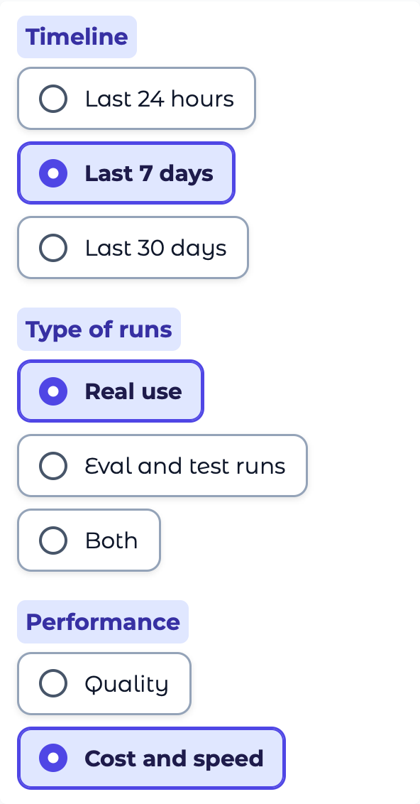

# More people at once, the Dashboard's choices in groups, and a layout re-check

**Run:** 2026-11-07, a local copy of the app with the real data (Neon, Langfuse), opened in emulated browsers (Chromium and WebKit). The concurrency change was merged as #77; the rest is in the PR that adds this page. **Not tested on real devices.**

## Why

Testers reported screens appearing slowly on Railway, and sign-up was about to open to more people (the limit is now 100, `CREDITCOACH_SIGNUP_MAX`). The Railway plan wasn't the cause: Gradio runs each event (a page-load step, an answer) for one person at a time unless told otherwise, and answers were held to 2 at once.

## What changed

| # | Change | Where |
|---|---|---|
| 1 | Page steps run for 16 people at once (Gradio's default is 1), answers for 8 (was 2) | [main.py](../../../creditcoach/app/main.py) `PAGE_CONCURRENCY`, `ANSWER_CONCURRENCY` (#77) |
| 2 | The Dashboard reads its traces when its tab is first opened, not at every page load | [main.py](../../../creditcoach/app/main.py) `open_dashboard` (#77) |
| 3 | The search models take one call at a time: two answers searching together crashed the app on a Mac's GPU | [retrieve.py](../../../creditcoach/rag/retrieve.py) (#77) |
| 4 | Default sign-up limit 50 → 100 | [config.py](../../../creditcoach/config.py) (#77) |
| 5 | People opening the Dashboard together share one read of Langfuse. Each used to read it, and Langfuse answered **429 Too Many Requests**; the tab then showed the container's near-empty local files for a minute | [dashboard.py](../../../creditcoach/app/dashboard.py) `load` |
| 6 | The Dashboard's choices are grouped and named: **Timeline** (Last 24 hours, Last 7 days, Last 30 days), **Type of runs** (Real use, Eval and test runs, Both) and **Performance** (Quality, Cost and speed), one group per line with its name beside it, above it on phones; Refresh below | [main.py](../../../creditcoach/app/main.py), [dashboard.py](../../../creditcoach/app/dashboard.py) `CSS` |
| 7 | iPad mini (744px): "Ask CreditCoach" was cut off in the main tabs. Between 601 and 800px the tabs now size to their words | [theme.py](../../../creditcoach/app/theme.py) |
| 8 | 320px phone in Safari: "Dashboard" ran 5px into its tab's edge. On phones the tabs now share the width equally but never shrink below their longest word | [theme.py](../../../creditcoach/app/theme.py) |

## Load test: 20 people at once

All 20 log in at the same moment, open every tab, then ask a question together. Models on the CPU, as on Railway; answer cache off; memory in a scratch folder; the 40 answers are tagged `script:load_test`, so the Dashboard counts them under "Eval and test runs".

| Seconds after Log in (answer: after Enter) | Before (median / slowest) | After (median / slowest) |
|---|---|---|
| App page | 0.8 / 1.8 | 0.9 / 1.8 |
| Header and counter | 2.8 / 3.1 | 2.9 / 4.7 |
| My credit | 3.4 / 4.0 | 3.0 / 4.8 |
| Dashboard | 12.6 / 12.8 | 6.8 / 7.5 |
| **Answer** | **44.2 / 78.6** | **13.3 / 22.7** |

Memory: the app uses about 840 MB and each answer's tool server about 110 MB, so 8 answers at once need about 2 GB.

## Screen sizes

24 sizes × light and dark × 4 states (chat, My credit, Dashboard Quality, Dashboard Cost and speed), in Chromium and in WebKit (Safari's engine): **384 captures, 0 faults** after the fixes. The sizes: phones from 320px to 430px and one in landscape, iPad mini, iPad, iPad Air, iPad Pro 11" and 13", iPad landscape, laptops at 1280 and 1440px, MacBook Air 14" (1470), MacBook Pro 14" (1512) and 16" (1728), a 15" laptop at 1920, iMac 24" (2240) and 27" (2560), and ultra-wide monitors at 3440 and 5120px.

Checked on each: no sideways scrolling; no element off-screen outside a scroll box; every tab whole and on screen; the Dashboard's groups and options on screen, not overlapping and not cut off. Before the fixes, Chromium found the iPad mini tabs (8 captures) and WebKit the 320px tabs (8 captures).

**Dashboard choices, MacBook Pro 14", dark mode**

**Dashboard choices, 320px phone**

**Tabs, 320px phone, Safari.** Before: "Dashboard" runs into its tab's edge. After: each tab has room for its longest word.

| Before | After |
|---|---|
|  |  |

## Not checked

- **Real devices.** All results are emulated browsers.
- **Production under load.** The load test ran locally; Railway's CPU is shared, so its times will differ.
