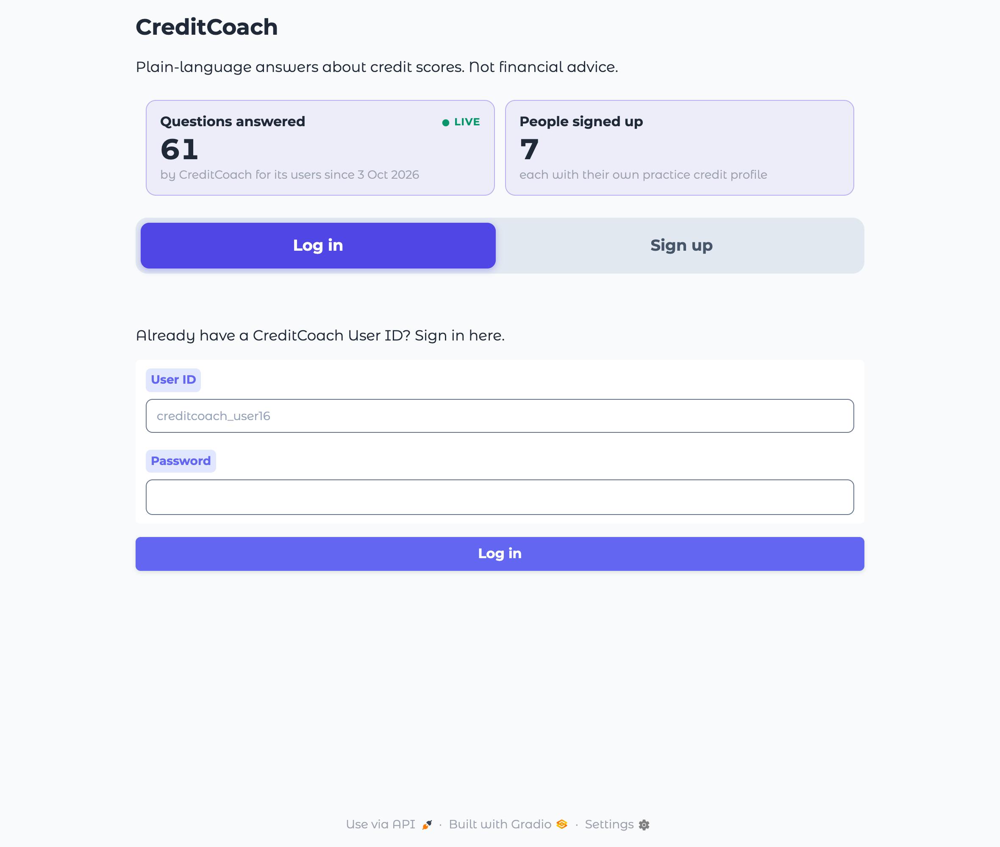
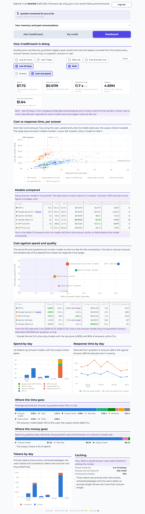

# Cost and speed on the dashboard, and usage counters

*Generated by `uv run --with playwright python scripts/cost_speed_and_counters.py`*

**Run:** 2026-11-01 05:05 UTC. Dashboard: last 30 days, both kinds of traffic, from Langfuse (https://jp.cloud.langfuse.com): every machine that sends it traces. Counters: Neon.

## What was added (2026-11-01)

| Where | What | From |
|---|---|---|
| Dashboard tab, "Cost and speed" view ([dashboard.py](../../../creditcoach/app/dashboard.py)) | Spend, cost per answer, response time (p50, p95), tokens and cost per 1M tokens; cost against response time per answer; each answer model compared; spend, response time and tokens by day; where the time and the money go, by pipeline step; caching | Each answer's trace (Task 26): its `llm.chat` spans' cost and tokens, by the step they sit under (`agent` is the answer model; under `guardrail.output`, the output check or a rewrite), and every step's duration. Eval judges' calls are left out |
| Same view, "Cost against speed and quality" | The 50-case eval runs per model: passed, median, 90% within, cost per answer, against the 15 s target | [model_comparison.json](../../../creditcoach/evals/model_comparison.json), written by [scripts/model_comparison.py](../../../scripts/model_comparison.py) from the runs in [runs/](runs/) |
| Welcome page ([counters.py](../../../creditcoach/app/counters.py)) | Questions answered (live, every 30 s) and people signed up | Memory in Neon: answers in chat-app sessions only; users made by the Sign up form |
| Above the chat | Questions answered for the signed-in user, across their sessions | The same, for that user; counted up in the page as answers arrive |

## The figures in this run

| Measure | Value |
|---|---|
| Questions answered (Neon, chat app) | 61 since 3 Oct 2026 |
| People signed up | 7 |
| Answers for USR-001 | 0 across 0 sessions |
| Answers on the dashboard | 650 |
| Spend | $7.72 |
| Cost per answer (p95) | $0.0119 ($0.0272) |
| Response time p50 (p95) | 11.7 s (28.8 s) |
| Tokens (prompt share) | 4,694,256 (90%) |

| Answer model | Answers | p50 | p95 | Cost per answer |
|---|---|---|---|---|
| GPT-5 | 342 | 16.2 s | 34.3 s | $0.0107 |
| Claude Sonnet 5.5 | 107 | 10.5 s | 18.5 s | $0.0249 |
| Gemini 3.8 Flash | 55 | 9.8 s | 18.6 s | $0.0069 |
| Claude Haiku 5.5 | 55 | 9.3 s | 14.3 s | $0.0016 |
| GPT-5.6 Terra | 55 | 6.8 s | 12.7 s | $0.0164 |
| No model call | 31 | 2.2 s | 4.4 s | $0.0000 |
| GPT-5.6 Luna | 5 | 10.4 s | 12.2 s | $0.0024 |

50-case eval runs (the comparison shipped with the app):

| Model | Passed | Median | 90% within | Cost per answer |
|---|---|---|---|---|
| GPT-5 | 43/50 | 20.4 s | 30.8 s | $0.0118 |
| Claude Sonnet 5.5 | 43/50 | 10.4 s | 14.9 s | $0.0256 |
| GPT-5.6 Terra | 39/50 | 6.8 s | 10.9 s | $0.0159 |
| Gemini 3.8 Flash | 41/50 | 9.7 s | 17.6 s | $0.0067 |
| Claude Haiku 5.5 | 36/50 | 9.2 s | 12.2 s | $0.0013 |

## Checks

- ✅ The welcome page shows the questions answered in Neon
- ✅ The welcome page shows the people signed up in Neon
- ✅ The signed-in counter shows the user's answers in Neon
- ✅ The signed-in counter goes up by one after an answer
- ✅ Cost and speed: the tiles show the spend in the traces
- ✅ Cost and speed: the tiles show the median response time
- ✅ Real data: answers were found in the period

## Screenshots

The real app, run locally and driven in headless Chrome, with a login and a memory folder that existed only for this run.

### 1. Welcome page: questions answered and people signed up

### 2. Signed in: the user's own counter

### 3. After one answer: the counter went up by one

### 4. Dashboard, "Cost and speed": last 30 days, both kinds of traffic

