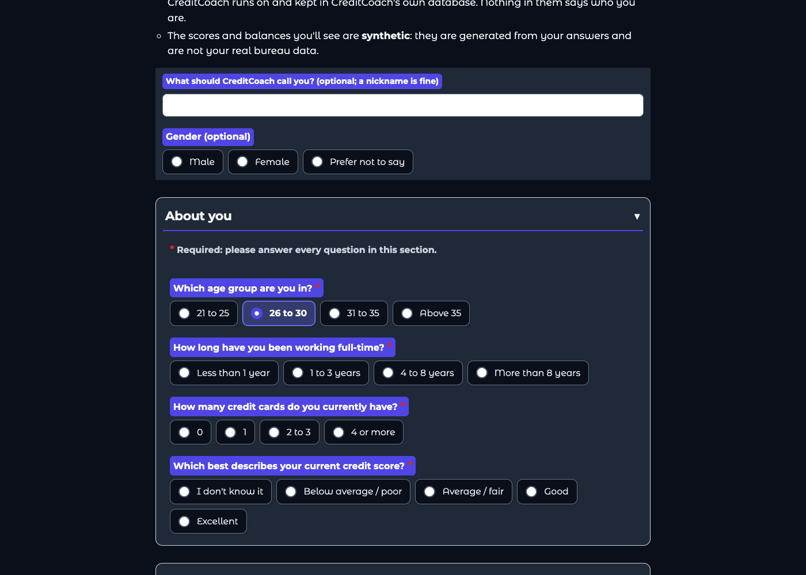
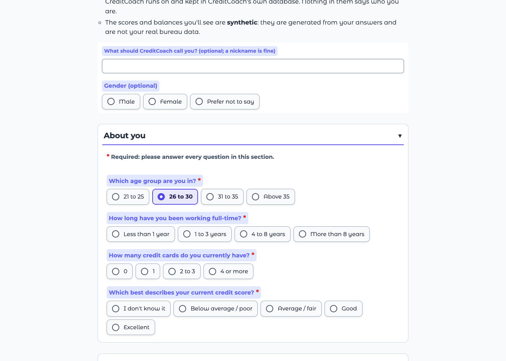
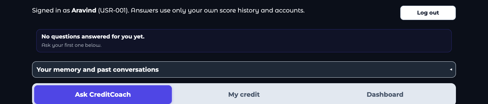
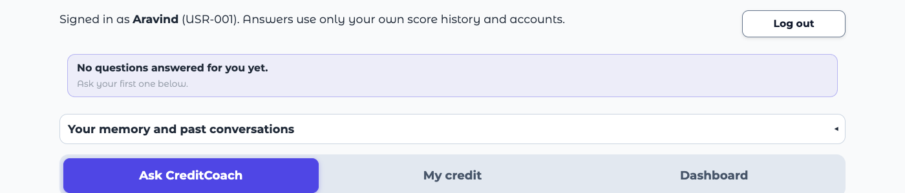
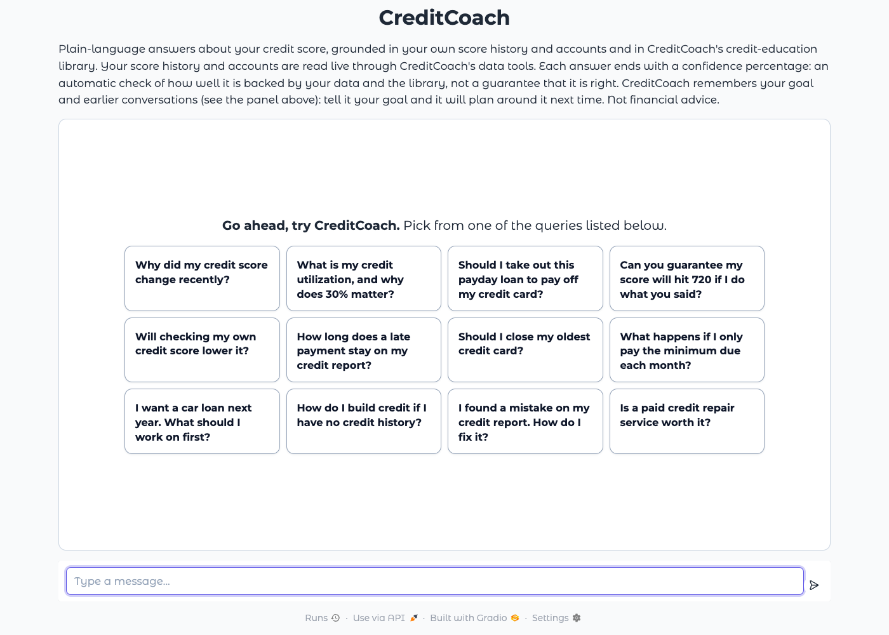
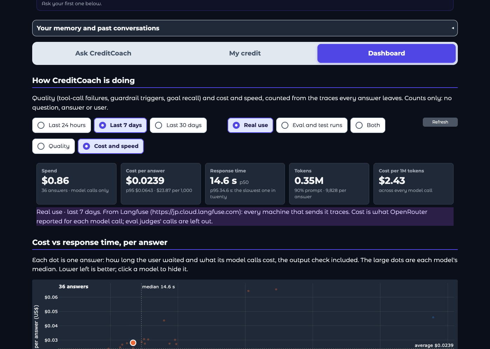
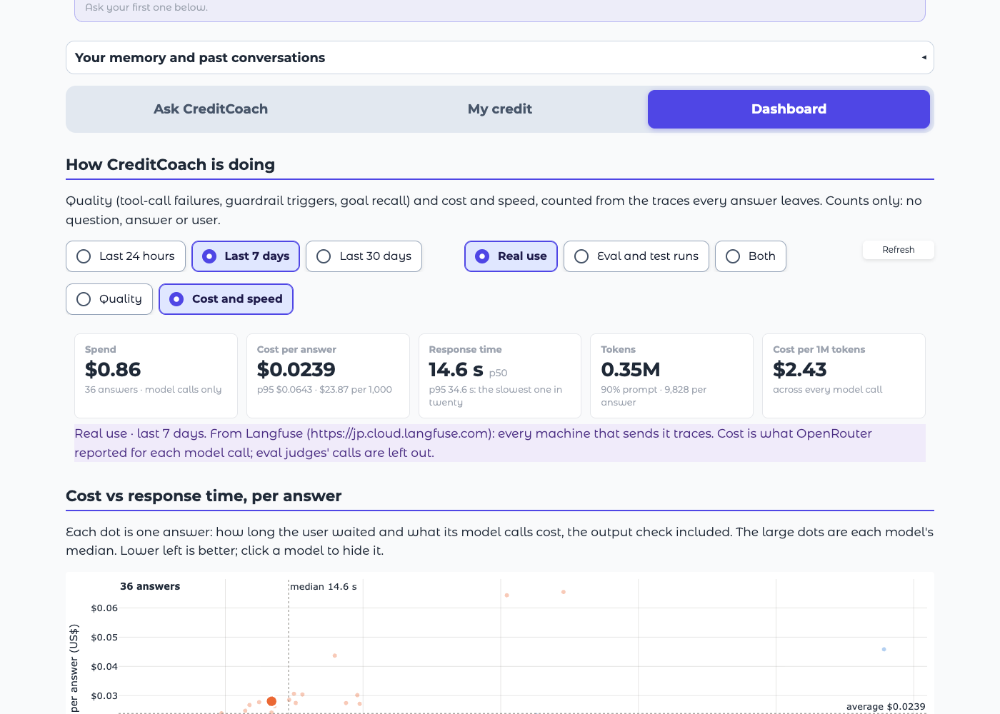
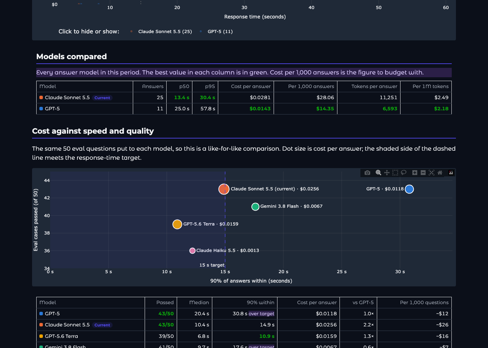
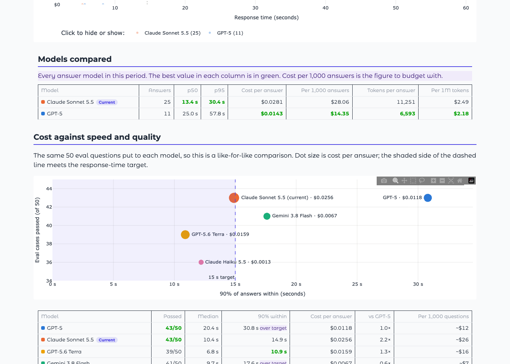

# Readable in dark mode, and a fuller chat

**Run:** 2026-11-01, the app run locally (no Neon, tracing off; the dashboard read the team's Langfuse) and opened in headless Chrome in light and dark mode. No model calls.

## Why

Testers who opened https://creditcoach-production.up.railway.app with their browser in dark mode reported four problems:

1. **Sign-up options couldn't be read.** The option words were always dark navy (`#0f172a`), but in dark mode the option boxes take the page's dark fill, so the words disappeared. People couldn't tell what they were picking.
2. **Log out was invisible.** The button was white, with no word color of its own, so dark mode gave it white words. It only showed on hover.
3. **The chat box looked empty.** Four example questions sat in the middle of a tall box.
4. **Chart labels were faint.** Axis numbers, axis titles and legends were mid grey (`#898781`) at 12 px, and nothing said the legend entries could be clicked.

## What changed

| Problem | Fix | Where |
|---|---|---|
| Sign-up options | In dark mode only: near-white option words, brighter outlines, the picked option filled indigo with white bold words; the "Required" note brighter | [welcome.py](../../../creditcoach/app/welcome.py) `CSS` |
| Log out | Dark words on the white button in both themes (hover still turns it indigo) | [theme.py](../../../creditcoach/app/theme.py) |
| Chat box | 12 example questions (the original 4 plus 8, each matching a library topic: checking your own score, late payments, closing an old card, the minimum due, planning a car loan, no credit history, report mistakes, credit repair services), with the note "**Go ahead, try CreditCoach.** Pick from one of the queries listed below." above them, both centred in the box. The note goes once the first question is asked | [main.py](../../../creditcoach/app/main.py) `EXAMPLES`, `PICK_PROMPT`; spacing in [theme.py](../../../creditcoach/app/theme.py) |
| Chart labels | Axis numbers, axis titles, legends and dot labels in the page's text color (near-white in dark mode, near-black in light), hover boxes untouched; text 13 px, axis titles 14 px; every legend starts "Click to hide or show:" (since the [model tick boxes](scatter-model-choice.md), the cost vs response time legend is a color key instead) | [theme.py](../../../creditcoach/app/theme.py), [dashboard.py](../../../creditcoach/app/dashboard.py) `_figure` |

Light mode looks as before, apart from the chart labels being darker and slightly larger.

Found while checking: making the legend words bold in CSS clipped the last entry ("GPT-5 (11"), because Plotly sizes the legend for its own font. The legend keeps its normal weight.

## Screenshots

| | Dark | Light |
|---|---|---|
| Sign-up options (one picked) |  |  |
| Log out |  |  |
| Note and 12 example questions |  |  |
| Dashboard summary above the cost against response time chart |  |  |
| Legend, models compared, cost against speed and quality |  |  |

The dashboard figures are the local run's "Real use, last 7 days", not the deployed app's.

## Not changed

The small colored dots in the cost against response time legend are still faint: they share the see-through color of the chart's dots, and Plotly has no separate setting for the legend's.

## Tests

7 pytest tests in [tests/test_theme.py](../../../tests/test_theme.py): 12 different example questions with both guardrail examples kept; the note; light option words in dark mode (and dark ones in light); Log out's own word color; chart text in the page's text color with hover boxes left alone; the legend's "Click to hide or show".
