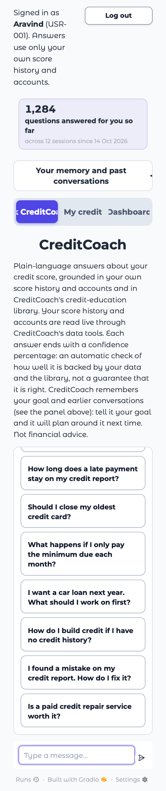
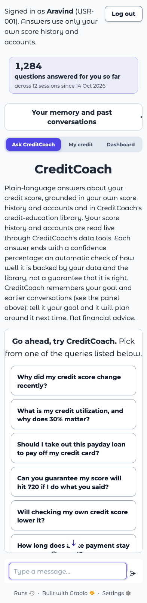
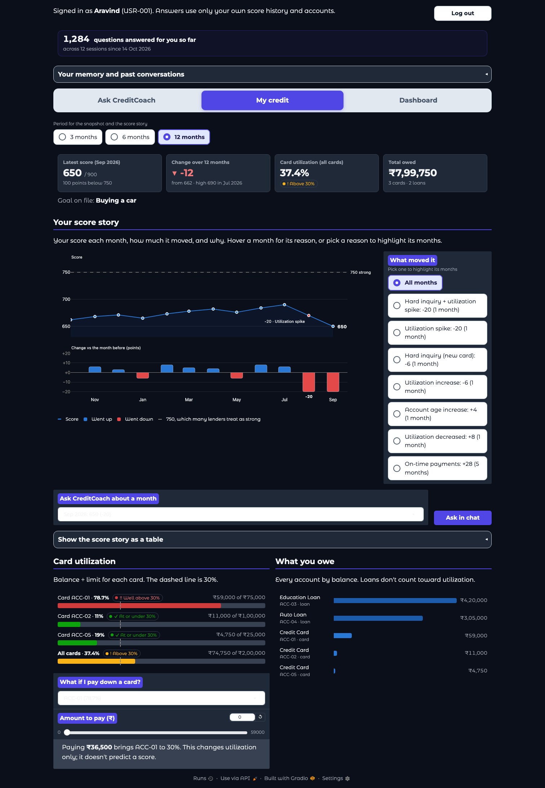
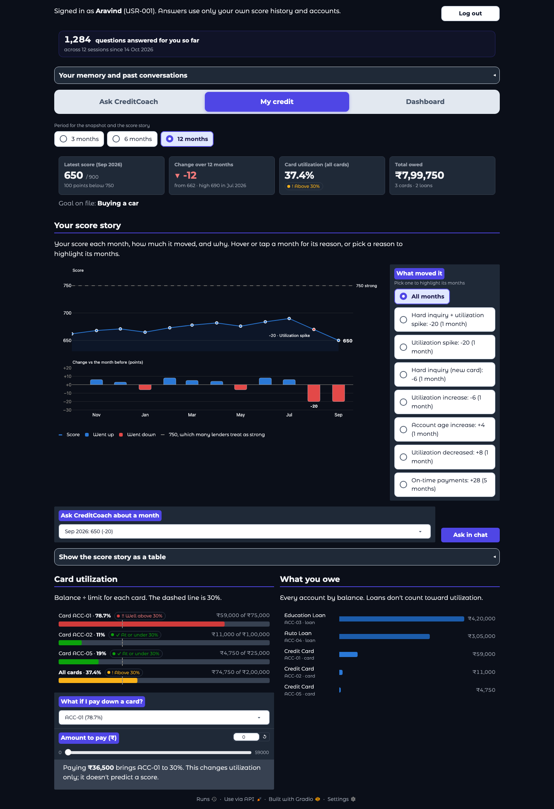

# Layout on phones and tablets, and dropdowns in dark mode

**Run:** 2026-11-02, a local copy of the app with canned chat answers and sample data (no model calls), opened in emulated browsers (Chromium and WebKit). Merged as #72. **Not tested on real devices.**

## Why

A test of https://creditcoach-production.up.railway.app across screen sizes found no sideways scrolling, but phones had real layout bugs and dark mode had unreadable dropdowns on every size. The "What if I pay down a card?" dropdown was also reported as unreadable on production in dark mode; it is the same bug as the month picker (row 3).

## What changed

| # | Problem | Fix | Where |
|---|---|---|---|
| 1 | Tab labels cut off below about 600px ("k CreditCoa") | Compact tabs that fit, wrapping to two lines at 320px | [theme.py](../../../creditcoach/app/theme.py) |
| 2 | On phones the invitation and first example questions sat above the top of the scroll area, out of reach, and the page opened scrolled down to the message box | All 12 can be reached; the page and the empty chat open at the top | [theme.py](../../../creditcoach/app/theme.py), [main.py](../../../creditcoach/app/main.py) `OPEN_AT_TOP_JS` |
| 3 | Month and card dropdowns on My credit: near-white text on a white field in dark mode | Dark text and a visible arrow | [theme.py](../../../creditcoach/app/theme.py) |
| 4 | "I have saved my User ID and password" cut off at 375px and narrower | It wraps | [welcome.py](../../../creditcoach/app/welcome.py) |
| 5 | Chart legends cut off on phones and iPad portrait | The legend title sits above the entries | [dashboard.py](../../../creditcoach/app/dashboard.py) |
| 6 | Chart toolbar covered chart titles on touch screens | Hidden on touch screens; desktop unchanged | [theme.py](../../../creditcoach/app/theme.py) |
| 7 | Tables in chat answers broke words mid-word on phones | Tables scroll sideways | [theme.py](../../../creditcoach/app/theme.py) |
| 8 | Muted labels in light mode at 2.2–2.5:1 contrast | About 7.6:1, set through Gradio's variables for light mode only; a few other low-contrast labels fixed too | [theme.py](../../../creditcoach/app/theme.py), [welcome.py](../../../creditcoach/app/welcome.py), [counters.py](../../../creditcoach/app/counters.py), [dashboard.py](../../../creditcoach/app/dashboard.py) |
| 9 | Smaller phone issues | More room beside Log out, a chat box that fits the screen, 32px chat icons on touch, room for the "-20" chart label, "Hover or tap a month" | [theme.py](../../../creditcoach/app/theme.py), [charts.py](../../../creditcoach/app/charts.py), [main.py](../../../creditcoach/app/main.py) |
| 10 | Larger screens | Four tiles sit 2×2 on iPad; long paragraphs are capped in width | [charts.py](../../../creditcoach/app/charts.py), [theme.py](../../../creditcoach/app/theme.py) |

Also visible on desktop: the page opens at the top instead of jumping to the message box, legend titles sit above the entries, and the "Change vs the month before" axis extends a little lower.

**For whoever edits the styles next:** inside `@media`, Gradio serves only its rescoped copy of a selector, so a rule naming `.gradio-container` there matches nothing. `theme.py` explains this and `test_rules_in_a_media_query_can_match` guards against it.

## Screenshots

The figures on these pages are sample data, and the "questions answered" count is a canned value for the test.

**Phone, 393px, light mode.** Before: the tabs are cut off and the list starts part-way through. After: the tabs fit, and the invitation and first question are in view.

| Before | After |
|---|---|
|  |  |

**Laptop, 1512px, dark mode.** Before: "Ask CreditCoach about a month" and "What if I pay down a card?" look empty. After: both read clearly.

| Before | After |
|---|---|
|  |  |

## What was checked

- **22 screen sizes × light and dark × 13 page states (572 captures, 0 failed):** phones from 320px to 430px and one in landscape, iPads, laptops from 1280px to 1920px, iMacs, and ultra-wide monitors up to 5120px. No sideways scrolling, nothing off-screen, no cut tabs, no chart text cut off.
- **The card dropdown in dark mode**, closed, open and after picking another card, in Chromium and WebKit at 1624, 1512 and 393px: dark text on white when closed, light text on a dark list when open.
- **Production before the fix** showed the same tab, example-question, dropdown and contrast measurements as the local copy.
- **Tests:** 8 new in `tests/test_theme.py`; full suite 794 passed.

## Not checked, or left as it is

- **Real devices.** All phone and tablet results are emulated, and production has not been rechecked since the merge.
- **iOS zoom.** Input text is still under 16px, so iOS Safari may zoom when a field is tapped.
- **Primary buttons.** White on indigo stays at 4.47:1, just under the 4.5:1 guideline, to keep the brand color.
- **Larger label sizes in `theme.py`.** They have never applied, for the same reason as the `@media` note above. Left alone because applying them would visibly change the design.
- **Chat icon size at 360px.** The full test run measured 18px icons on the Android 360px profile, but a fresh browser measured 32px every time. This is probably a test artifact, not proven.
- **Scroll arrow.** On phones, Gradio's scroll-down arrow sits over the example question below it while the list isn't at the bottom (visible in the phone screenshot above).
