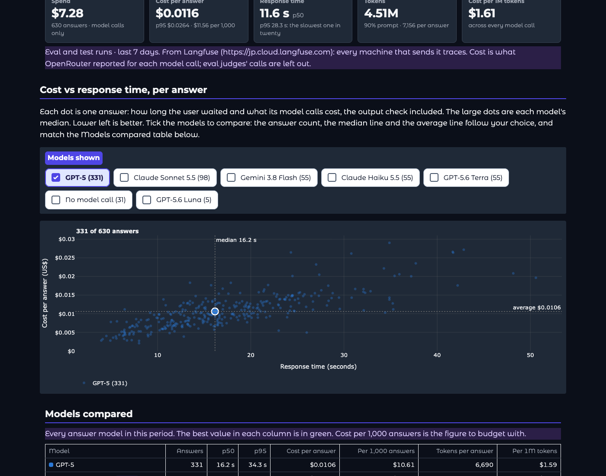
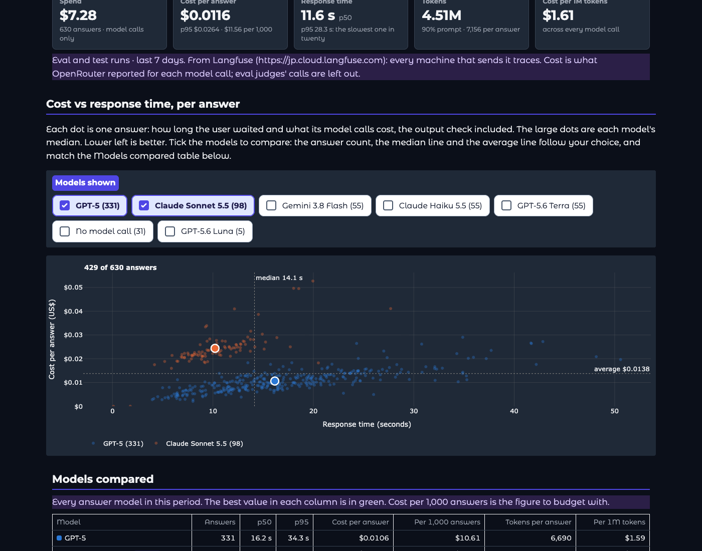
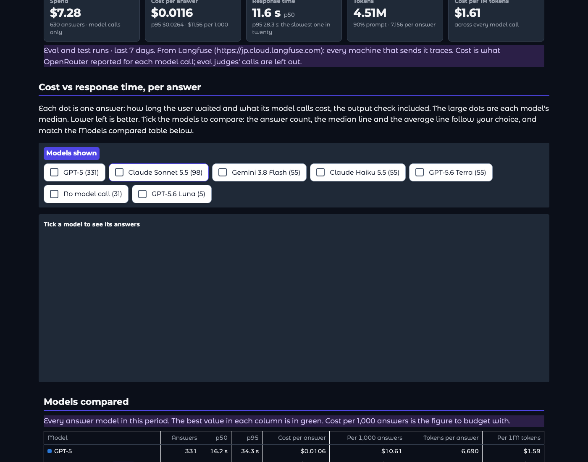
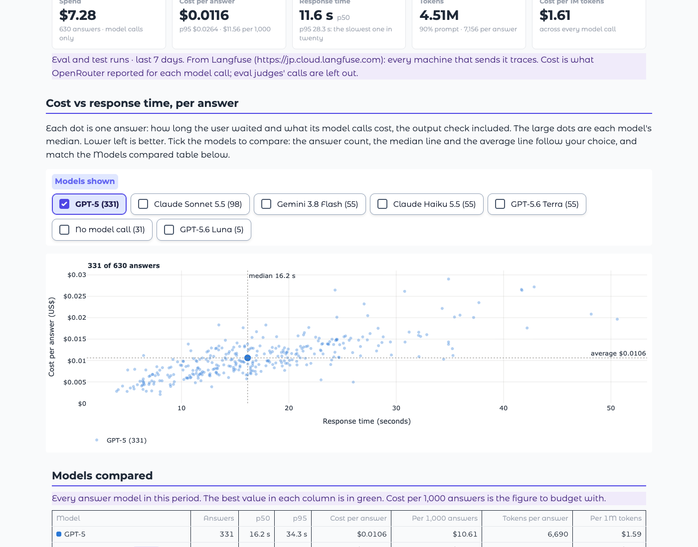
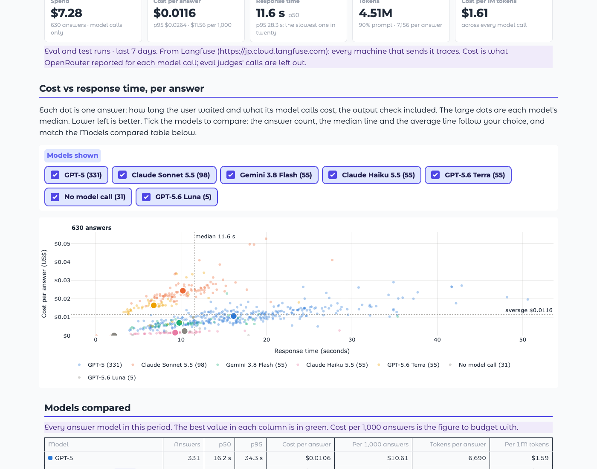

# Cost vs response time: the figures follow the models shown

**Run:** 2026-11-01, the app run locally against the team's Langfuse traces (read only; no Neon, tracing off) and driven in headless Chrome in dark and light mode. No model calls.

## The problem

On the Dashboard's **Cost and speed** view, the "Cost vs response time, per answer" chart showed **630 answers**, a **median 11.6 s** line and an **average $0.0116** line (eval and test runs, last 7 days). Clicking models in the legend hid their dots, but those three figures stayed the same, so they no longer described the dots on screen and didn't match the Models compared table below. That undermines trust in the whole view.

The legend click happens inside Plotly in the browser, and Gradio doesn't tell the server about it. Gradio's copy of Plotly isn't reachable from the page either, so the chart can't redraw its own lines. Recomputing in the browser would have meant rewriting the chart's SVG by hand, which breaks on zoom and resize and can't be tested.

## The fix

- **Models shown**: tick boxes above the chart, one per answer model with its answers (for example "GPT-5 (331)"), all ticked at first, most answers first. Answers with no model call (from the answer cache, or failed before the model answered) have their own box.
- Ticking redraws the chart on the server ([dashboard.py](../../../creditcoach/app/dashboard.py) `pick`, `scatter_figure`; [main.py](../../../creditcoach/app/main.py) `redraw_cost_scatter`): only the ticked models' dots, and the answer count, median line and average line of exactly those answers. With some models unticked, the count reads "331 of 630 answers".
- The figures are worked out the way the Models compared table works them out (`_speed`): answers and spend add up; the average is spend over answers; the median is taken over every ticked answer's response time, not averaged from each model's median. So one model shows its row in the table, and every model shows the tiles above.
- The chart is redrawn from the figures the rest of the view was made from, kept with the page, not from a fresh read of the traces, so it can't drift from the table when new answers arrive.
- The legend is now a color key that doesn't respond to clicks, so it can't hide dots that the figures still count. Other charts keep "Click to hide or show:", since they show no totals.
- With nothing ticked, the chart says "Tick a model to see its answers", with no axes.

## Checked

**Every combination, against the answers themselves.** For the last day, 7 days and 30 days, and for real use, eval and test runs and both, every combination of models (up to 128) was checked against the count, average and median worked out afresh from those answers' traces. Result: **0 mismatches**.

**In the real page, eval and test runs, last 7 days.** Each model ticked on its own, read off the chart, against its row in the Models compared table:

| Ticked | Chart | Models compared table |
|---|---|---|
| GPT-5 | 331 of 630 answers · median 16.2 s · average $0.0106 | 331 · p50 16.2 s · $0.0106 |
| Claude Sonnet 5.5 | 98 of 630 · 10.2 s · $0.0244 | 98 · 10.2 s · $0.0244 |
| Gemini 3.8 Flash | 55 of 630 · 9.8 s · $0.0069 | 55 · 9.8 s · $0.0069 |
| Claude Haiku 5.5 | 55 of 630 · 9.3 s · $0.0016 | 55 · 9.3 s · $0.0016 |
| GPT-5.6 Terra | 55 of 630 · 6.8 s · $0.0164 | 55 · 6.8 s · $0.0164 |
| GPT-5.6 Luna | 5 of 630 · 10.4 s · $0.0024 | 5 · 10.4 s · $0.0024 |
| No model call | 31 of 630 · 2.2 s · $0.0000 | not in the table (its note gives the 31) |
| Every model | 630 answers · 11.6 s · $0.0116 | the tiles: 630 answers, 11.6 s p50, $0.0116 |

Combinations, read off the chart and checked against the answers' traces (all match):

| Ticked | Chart |
|---|---|
| GPT-5 + Claude Sonnet 5.5 | 429 of 630 · median 14.1 s · average $0.0138 |
| Claude Sonnet 5.5 + Gemini 3.8 Flash | 153 of 630 · 10.0 s · $0.0181 |
| GPT-5 + GPT-5.6 Luna | 336 of 630 · 16.0 s · $0.0105 |
| GPT-5, Claude Sonnet 5.5, Gemini 3.8 Flash, Claude Haiku 5.5 | 539 of 630 · 12.7 s · $0.0118 |

Same figures in light mode.

Found while checking: the new redraw handler was first named `cost_scatter`, the same name as the chart component inside the page builder, so the app failed to start. It is now `redraw_cost_scatter`, and a test builds the whole page.

## Screenshots

| | |
|---|---|
| One model (dark) |  |
| Two models (dark) |  |
| None ticked (dark) |  |
| One model (light) |  |
| Every model (light) |  |

## Tests

9 more pytest tests in [tests/test_dashboard.py](../../../tests/test_dashboard.py): a choice of one or both models matches the figures worked out from those answers (3 cases); one model gives its table row and every model the tiles, with a median of 16 s, not the medians' mean of 15.5 s; the chart draws only the ticked models with their count and lines; nothing ticked; the tick-box labels, including answers with no model call; the redraw uses the view's own figures and needs a signed-in user; the page builds with the tick boxes wired up. 2 existing tests were updated for the view's two new outputs.
