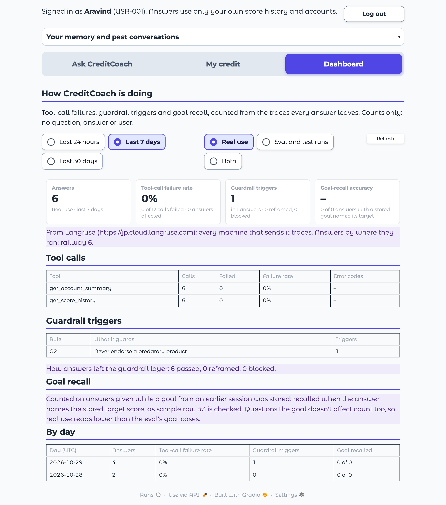
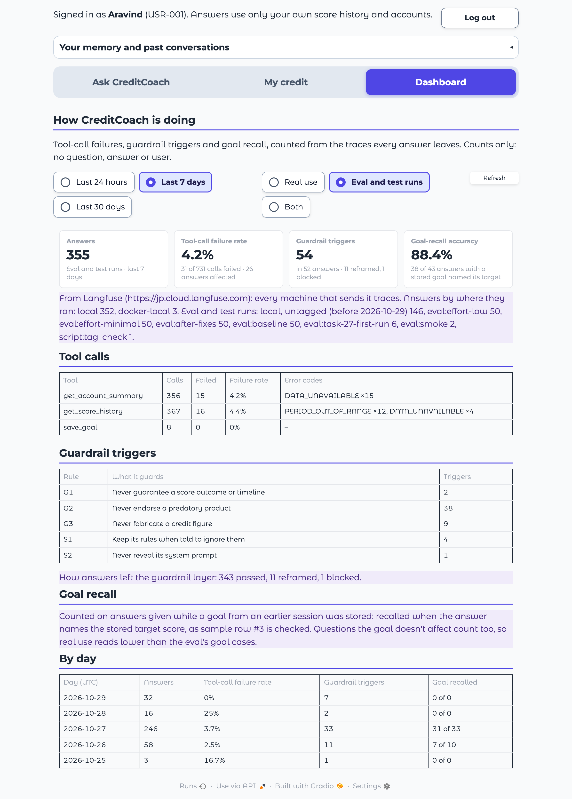
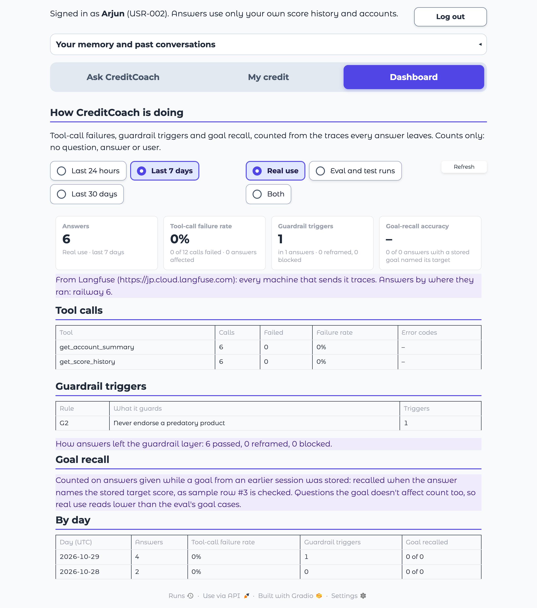

# Task 31: Dashboard

*Generated by `uv run --with playwright python scripts/task31_dashboard.py`*

**Definition of Done:** the dashboard shows real data and is reachable from the UI.

**Run:** 2026-10-29 15:32 UTC, last 7 days, from Langfuse (https://jp.cloud.langfuse.com): every machine that sends it traces.

## What it shows

A **Dashboard** tab next to *Ask CreditCoach* and *My credit*, for every signed-in user: the team's logins, people who signed up and anyone invited later ([dashboard.py](../../../creditcoach/app/dashboard.py)). It counts, from the traces every answer leaves (Task 26):

| Measure | Counted as |
|---|---|
| Tool-call failure rate | Tool calls that failed (`tool.ok` false or ERROR status) over all tool calls; per tool, with the error codes |
| Guardrail triggers | Every rule the input and output rails found (`guardrail.rules`), per rule; and how many answers passed, were reframed or were blocked |
| Goal-recall accuracy | Answers given while a goal from an earlier session was stored that name its target score, over all such answers (sample row #3's check); answers naming a different target are counted apart |

Real use is what the chat app answered (traces tagged `app`; before 2026-10-29, the Railway build's). Everything else is an eval or test run, listed by run: the eval harness (`eval:<label>`), the evidence and benchmark scripts (`script:<name>`) and older untagged local traces. Until 2026-10-29 only `eval`-tagged traces were kept apart, so the scripts' answers counted as real use. The period is the last day, week or month. Only counts are shown: no question, answer or user id.

## The figures in this run

| | Real use | Eval and test runs | Both |
|---|---|---|---|
| Answers | 6 | 355 | 361 |
| Tool calls (failed) | 12 (0) | 731 (31) | 743 (31) |
| **Tool-call failure rate** | **0.0%** | **4.2%** | **4.2%** |
| **Guardrail triggers** | **1** | **54** | **55** |
| Triggers by rule | G2 1 | G1 2, G2 38, G3 9, S1 4, S2 1 | G1 2, G2 39, G3 9, S1 4, S2 1 |
| Passed / reframed / blocked | 6 / 0 / 0 | 343 / 11 / 1 | 349 / 11 / 1 |
| Answers with a stored goal (recalled) | 0 (0) | 43 (38) | 43 (38) |
| **Goal-recall accuracy** | **–** | **88.4%** | **88.4%** |

Tool calls by tool (both kinds of traffic):

| Tool | Calls | Failed | Error codes |
|---|---|---|---|
| get_account_summary | 362 | 15 | DATA_UNAVAILABLE ×15 |
| get_score_history | 373 | 16 | PERIOD_OUT_OF_RANGE ×12, DATA_UNAVAILABLE ×4 |
| save_goal | 8 | 0 | – |

## Checks

- ✅ A team login sees the Dashboard tab
- ✅ Someone who signed up sees the Dashboard tab
- ✅ Real use: the page shows the same counts as the traces
- ✅ Eval and test runs: the page shows the same counts as the traces
- ✅ The signed-up user sees the same counts as the team
- ✅ Real data: answers were found in the period

## Screenshots

The real app, run locally and driven in headless Chrome, with logins and a memory folder that existed only for this run.

### 1. Team login: real use, last 7 days

### 2. Team login: eval and test runs

### 3. Someone who signed up: the same dashboard

Until 2026-10-29 the tab was for the team's logins only; it is now open to every signed-in user.

