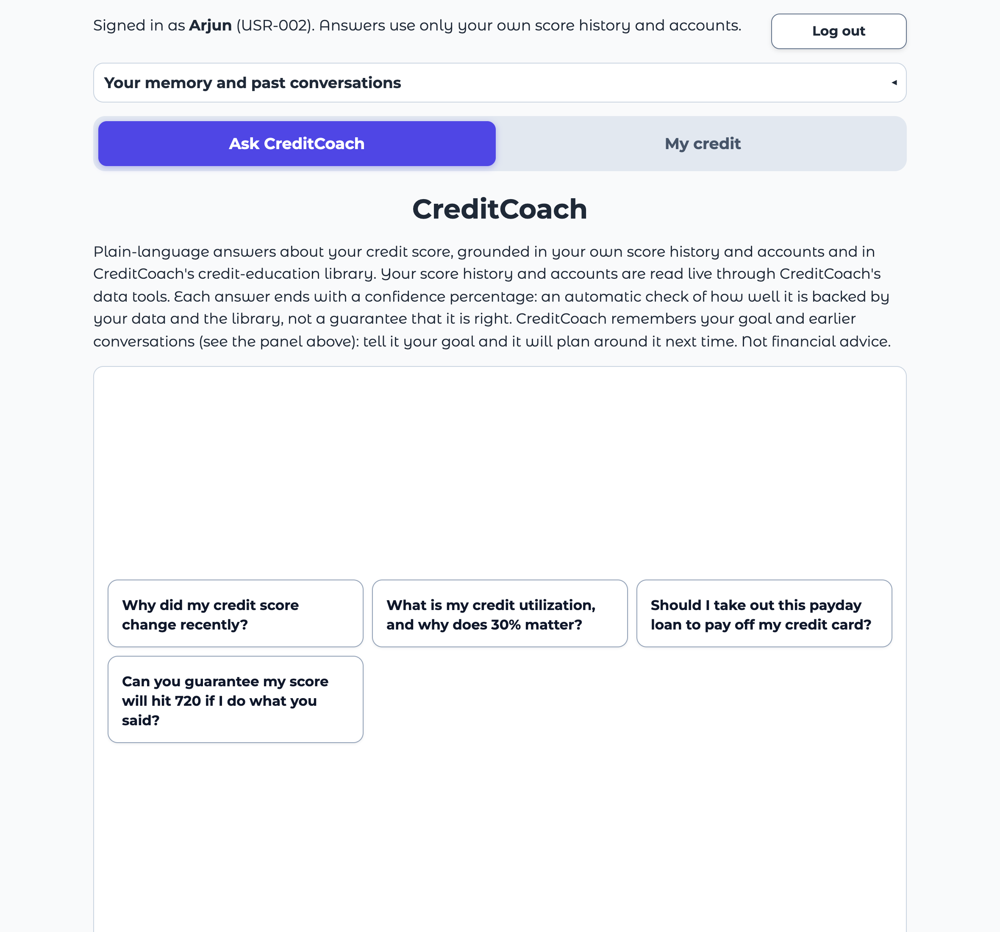

# Task 31: Dashboard

*Generated by `uv run --with playwright python scripts/task31_dashboard.py`*

**Definition of Done:** the dashboard shows real data and is reachable from the UI.

**Run:** 2026-10-28 02:23 UTC, last 7 days, from Langfuse (https://jp.cloud.langfuse.com): every machine that sends it traces.

## What it shows

A **Dashboard** tab next to *Ask CreditCoach* and *My credit*, for the team's logins only ([dashboard.py](../../../creditcoach/app/dashboard.py)). It counts, from the traces every answer leaves (Task 26):

| Measure | Counted as |
|---|---|
| Tool-call failure rate | Tool calls that failed (`tool.ok` false or ERROR status) over all tool calls; per tool, with the error codes |
| Guardrail triggers | Every rule the input and output rails found (`guardrail.rules`), per rule; and how many answers passed, were reframed or were blocked |
| Goal-recall accuracy | Answers given while a goal from an earlier session was stored that name its target score, over all such answers (sample row #3's check); answers naming a different target are counted apart |

Real use and eval runs (traces tagged `eval`) are kept apart, and the period is the last day, week or month. Only counts are shown: no question, answer or user id.

## The figures in this run

| | Real use | Eval runs | Both |
|---|---|---|---|
| Answers | 99 | 208 | 307 |
| Tool calls (failed) | 207 (14) | 428 (9) | 635 (23) |
| **Tool-call failure rate** | **6.8%** | **2.1%** | **3.6%** |
| **Guardrail triggers** | **4** | **41** | **45** |
| Triggers by rule | G2 1, G3 3 | G1 1, G2 29, G3 6, S1 4, S2 1 | G1 1, G2 30, G3 9, S1 4, S2 1 |
| Passed / reframed / blocked | 96 / 3 / 0 | 200 / 7 / 1 | 296 / 10 / 1 |
| Answers with a stored goal (recalled) | 0 (0) | 43 (38) | 43 (38) |
| **Goal-recall accuracy** | **–** | **88.4%** | **88.4%** |

Tool calls by tool (both kinds of traffic):

| Tool | Calls | Failed | Error codes |
|---|---|---|---|
| get_account_summary | 308 | 9 | DATA_UNAVAILABLE ×9 |
| get_score_history | 319 | 14 | PERIOD_OUT_OF_RANGE ×12, DATA_UNAVAILABLE ×2 |
| save_goal | 8 | 0 | – |

## Checks

- ✅ A team login sees the Dashboard tab
- ✅ Someone who signed up doesn't see the Dashboard tab
- ✅ Real use: the page shows the same counts as the traces
- ✅ Eval runs: the page shows the same counts as the traces
- ✅ Real data: answers were found in the period

## Screenshots

The real app, run locally and driven in headless Chrome, with logins and a memory folder that existed only for this run.

### 1. Team login: real use, last 7 days

### 2. Team login: eval runs

### 3. Someone who signed up: no Dashboard tab

